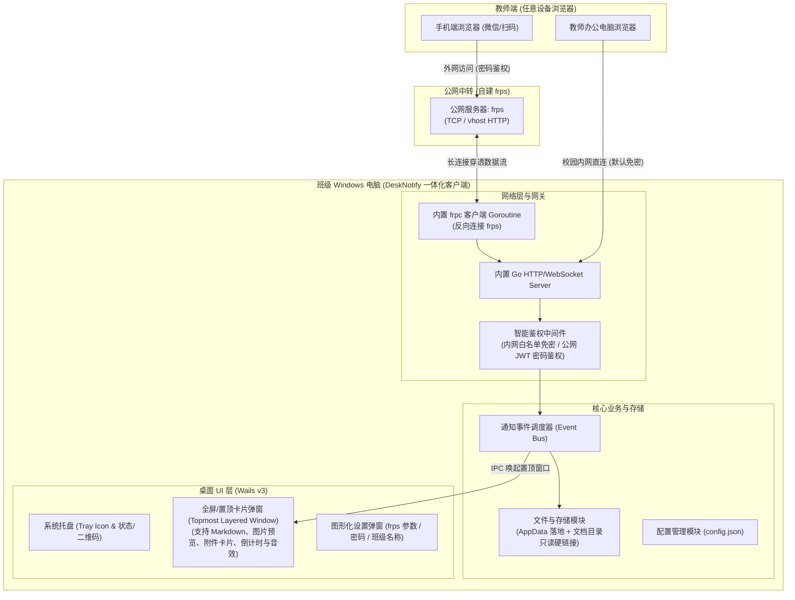
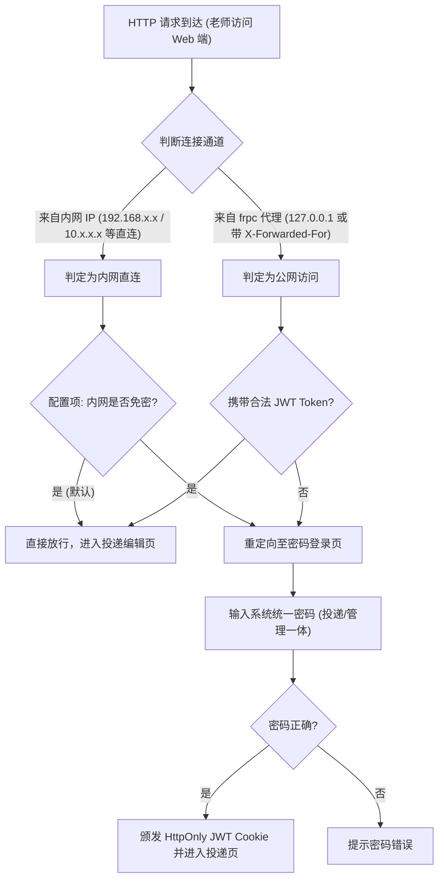

# DeskNotify 传纸条架构设计方案

## 1. 方案背景与目标定位

本系统专为学校班级教室场景打造。班级 Windows 电脑（白板、一体机或讲台电脑）运行单一轻量化绿色客户端，在后台静默运行并常驻系统托盘，同时启动本地 Web 服务并穿透到公网（基于 frp）。老师无需安装任何 App，在手机或电脑浏览器中打开对应网址即可一键投递富文本通知、图片及课件附件，班级大屏以醒目置顶卡片形式即时展示。

---

## 2. 总体架构图



---

## 3. 模块解耦与 Go Workspace (`go.work`) 隔离机制

针对“开发环境隔离 frp 繁重依赖，仅在打包构建时引入 frp SDK”的要求，采用 Go 1.18+ 的 **Multi-Module Workspace** 架构配合抽象接口驱动设计：

```
desk-notify/
├── go.work                  # 本地工作区配置文件（开发时可不引入 tunnel-frp）
├── go.work.sum
├── .github/
│   └── workflows/
│       └── release.yml      # GitHub Actions 自动化编译流水线
├── core/                    # 核心应用模块（业务、UI、Web 服务）
│   ├── go.mod
│   ├── main.go              # Wails v3 主入口
│   ├── pkg/
│   │   ├── tunnel/          # 穿透抽象接口
│   │   │   ├── tunnel.go    # interface: Start(), Stop(), Status()
│   │   │   └── mock.go      # 本地调试时的 No-op / Mock 穿透实现
│   │   ├── server/          # 嵌入式 Web 服务 (Gin / Chi / net/http)
│   │   ├── auth/            # 内网识别与公网密码 JWT 鉴权
│   │   ├── storage/         # AppData 与 Documents 硬链接存储
│   │   └── config/          # 本地配置管理
│   └── frontend/            # Web 前端资源（Vite + Tailwind + Vue3 / HTML）
│       ├── teacher/         # 教师 Web 投递端单页应用
│       ├── card/            # 桌面置顶通知卡片 UI
│       └── settings/        # 托盘设置与二维码窗口 UI
└── modules/
    └── tunnel-frp/          # 专属 frp SDK 模块（仅在完整构建时引入）
        ├── go.mod           # 依赖 github.com/fatedier/frp
        └── frp_tunnel.go    # 实现 tunnel.Tunnel 接口
```

### 构建策略（Build Tags）：
* 本地日常开发时：`go run` 使用 `-tags dev`，绑定 `mock.go`，依赖树纯净，秒级启动与热重载。
* Release 生产构建时：使用 `-tags release`，将 `tunnel-frp` 编译进最终二进制文件，产出无外部依赖的单文件 `.exe`。

---

## 4. 智能网络鉴权流程



---

## 5. 存储架构与硬链接设计

依据规范要求，系统采用 **嵌入式 SQLite3 数据库** 与 **双层文件存储** 相结合的方式：

1. **元数据持久化 (SQLite3)**：
   - 数据库路径：`%APPDATA%\DeskNotify\desk_notify.db`
   - 采用纯 Go 实现的驱动 `modernc.org/sqlite`（零 CGO 依赖，完美支持跨平台编译与原生 Windows 运行）。
   - 维护 `notifications`（通知记录）与 `attachments`（附件及图片元数据）两张核心表，支持事务写入与高效时间倒序索引。

2. **主附件存储路径 (AppData)**：
   - 路径：`%APPDATA%\DeskNotify\data\{YYYY-MM}\{msg_id}\`
   - 保存上传的原始图片与各类格式附件。

3. **公开可读硬链接路径 (Documents)**：
   - 路径：`%USERPROFILE%\Documents\班级通知\{YYYY-MM-DD}_{班级名称}\`
   - 对每一个附件和图片，使用 Win32 API `CreateHardLink`（Go 标准库 `os.Link`）在用户“我的文档”对应目录下创建硬链接。
   - 硬链接优势：不额外消耗磁盘空间，若学生在文档误删文件不影响 AppData 主库；写入后利用 Win32 文件属性标记为 `FILE_ATTRIBUTE_READONLY`（只读），防止误篡改。

---

## 6. 桌面置顶弹窗卡片 (Wails v3) 交互设计

* **窗口特性**：
  * 无边框 (`frameless: true`)，永远置顶 (`alwaysOnTop: true`)。
  * 窗口级别设置为浮动层级（避免全屏 PPT 放映或播放视频时被覆盖）。
  * 初始不可见 (`hidden: true`)，来信时触发动画滑动淡入。
* **卡片内容表现**：
  * **正文排版**：内置轻量 Markdown 渲染器，支持加粗、列表、高亮色块、超链接。
  * **多图展示**：支持网格自适应平铺，点击可大图缩放查看。
  * **附件卡片**：各类格式（Word、PPT、PDF、压缩包等）渲染为独立卡片，展示文件名、大小及“一键打开/在文件夹中查看”按钮。
  * **辅助交互**：右上方提供倒计时环形进度条（支持配置如 30 秒自动消失，或选择“必须手动确认后关闭”），来信时播放柔和提示音。

---

## 7. 教师端 Web 页面体验 (PWA)

* **技术栈**：Vue 3 + TypeScript + Vite + Tailwind CSS，使用 `pnpm` 包管理。
* **PWA 原生体验**：内置 `vite-plugin-pwa` 与 Service Worker，支持离线 Shell 缓存与“添加到手机主屏幕”，在手机端具备独立应用全屏沉浸体验。
* **易用性核心**：对老师隐藏 Markdown 源码语法，提供所见即所得风格的轻量富文本交互栏（粗体、标题大小、引用列表）。
* **极速贴图 (Ctrl+V)**：监听全局 `paste` 事件，教师截图后直接按 `Ctrl+V` 自动上传并插入正文预览区。
* **附件拖拽**：支持任意文件直接拖进浏览器区域，自动挂载为待发附件。
* **状态反馈**：点击发送后实时显示“正在投递 -> 教室大屏已接收并展示”，底部保留近 10 条该班级的投递历史。

---

## 8. GitHub Actions 自动化流水线 (`release.yml`)

1. **触发条件**：推送标签 `v*` (如 `git tag v1.0.0 && git push --tags`)。
2. **构建环境**：`windows-latest`。
3. **流程节点**：
   - 安装 Go 环境、Node.js 与 pnpm/npm。
   - 安装 Wails v3 CLI 工具。
   - 拉取并同步完整依赖（包含 `modules/tunnel-frp`）。
   - 编译前端资源与后端 Go 资源，嵌入图标与 Windows 应用清单（UAC execution level: asInvoker）。
   - 执行 `wails3 build` 输出单文件 `DeskNotify.exe`。
   - 自动生成 Release Note 并将 `.exe` 上传为 GitHub Release 产物。

---

## 9. 部署与自启维护

* **开机静默自启**：软件首次启动后，自动检测并可写入当前用户的注册表自启项 `HKCU\Software\Microsoft\Windows\CurrentVersion\Run`。
* **托盘管理**：
  - 左键点击托盘：显示投递二维码弹窗（便于当堂老师直接拿手机扫码投递）。
  - 右键托盘：
    - `查看状态` (内网 IP、公网穿透状态)
    - `设置` (修改班级名称、公网密码、frps 连接参数、弹窗保留时间)
    - `打开通知存档目录` (直接呼出资源管理器打开“我的文档/班级通知”)
    - `退出软件`
